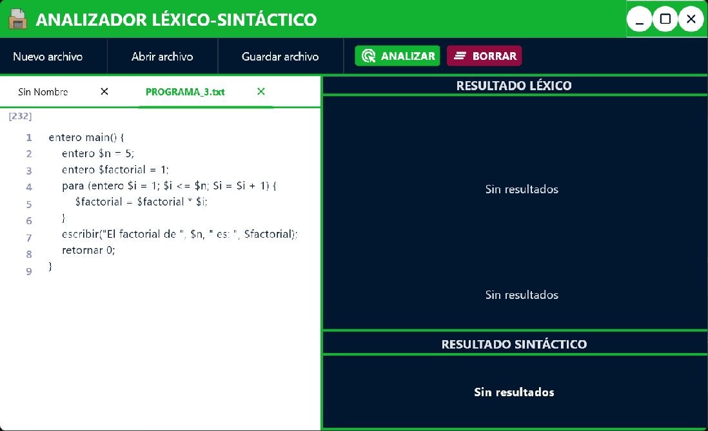
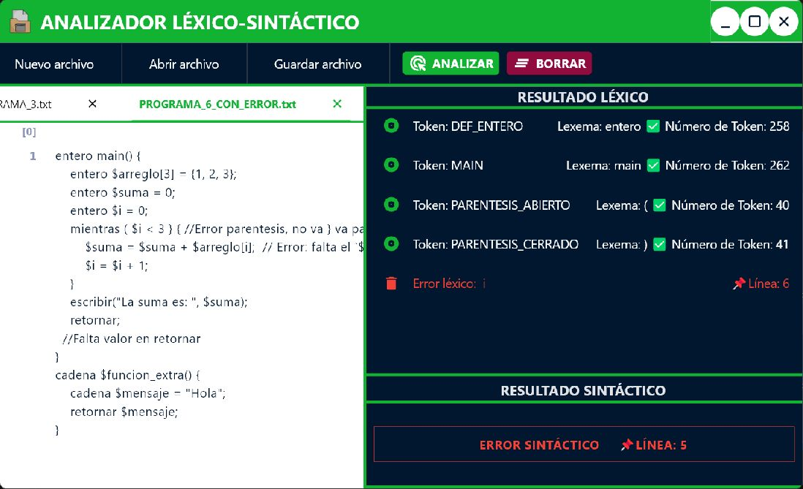
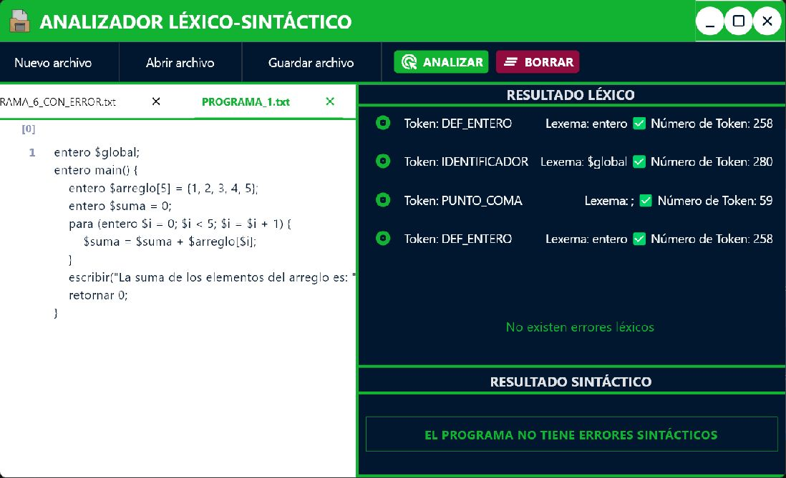

# Flet Brace Language Analyzer

Aplicación de escritorio que analiza archivos escritos en un lenguaje didáctico con palabras clave en español y bloques entre llaves. El editor está hecho con Python y Flet. Flex identifica los tokens y Bison comprueba la estructura del programa. La interfaz muestra los tokens, los errores léxicos y el resultado sintáctico.

## Capturas

### Editor con el ejemplo del factorial



### Análisis de un programa válido


### Diagnósticos léxico y sintáctico



### Arreglos e identificadores




## Gramática

| Elemento | Sintaxis |
| --- | --- |
| Identificadores | Empiezan por `$` y una letra. Después admiten letras, dígitos y guiones bajos. |
| Tipos | `entero`, `real`, `cadena` y `vacio`. |
| Declaraciones y asignaciones | `entero $total = 0;` y `$total = $total + 1;`. |
| Funciones | Una función tiene tipo, nombre, parámetros entre paréntesis y un bloque entre llaves. `main()` tiene una regla específica sin parámetros. |
| Control de flujo | `si` y `sino` permiten ramificar. `mientras` y `para` permiten repetir un bloque. |
| Entrada y salida | La gramática incluye `leer`, `escribir` y `retornar`. |

```text
entero main() {
    entero $n = 5;
    entero $factorial = 1;
    para (entero $i = 1; $i <= $n; $i = $i + 1) {
        $factorial = $factorial * $i;
    }
    escribir("El factorial de ", $n, " es: ", $factorial);
    retornar 0;
}
```

El ejemplo ilustra las reglas analizadas. La app comprueba el texto y muestra los diagnósticos. Las reglas completas están en [lexico.l](lexico.l) y [parser.y](parser.y).

## Ejecutar en Windows

Desde la raíz del repositorio, con Python y GCC de MinGW disponibles en el PATH:

```powershell
New-Item -ItemType Directory -Force build | Out-Null
gcc -std=gnu17 -Wno-implicit-function-declaration lexico.c parser.c -o build/analyzer.exe
py -m venv .venv
.\.venv\Scripts\python.exe -m pip install "flet[desktop]==0.26.0"
.\.venv\Scripts\python.exe src/main.py
```

El comando de GCC usa el código C generado incluido en el repositorio. En la app, abre un archivo de texto y pulsa el botón de análisis.

## Ejemplos

| Archivo | Resultado esperado |
| --- | --- |
| [Programa 1](examples/PROGRAMA_1.txt) | Válido. Recorre un arreglo y calcula la suma de sus elementos. |
| [Programa 2](examples/PROGRAMA_2.txt) | Válido. Comprueba si un número es primo. |
| [Programa 3](examples/PROGRAMA_3.txt) | Válido. Calcula el factorial con un bucle. |
| [Programa 4](examples/PROGRAMA_4_CON_ERROR.txt) | Diagnósticos léxicos y sintácticos. |
| [Programa 5](examples/PROGRAMA_5_CON_ERROR.txt) | Diagnósticos léxicos y sintácticos. |
| [Programa 6](examples/PROGRAMA_6_CON_ERROR.txt) | Un diagnóstico léxico y uno sintáctico. |
